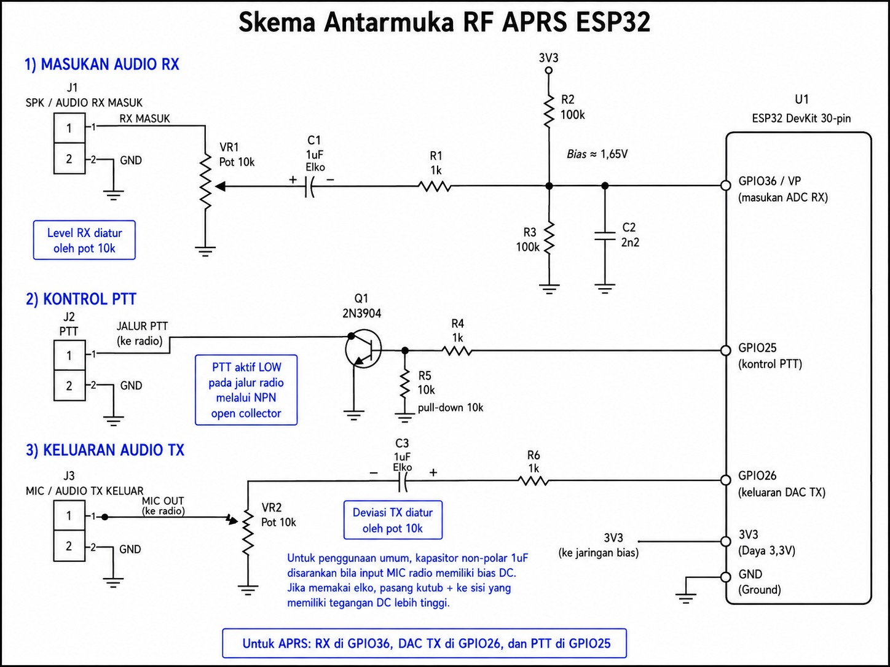

# NUSA APRS ESP32 — iGate + Digipeater REV1S

**Classic ESP32 WROOM / DevKit + external VHF radio — Bell 202 / AX.25 APRS 1200 baud**

🇮🇩 [Bahasa Indonesia](README_ID.md) · 🇬🇧 [English](README_EN.md)

NUSA APRS ESP32 combines an APRS RF iGate, RF digipeater, APRS-IS client, web configuration, SH1106/SSD1306 OLED display, weather parsing, last-heard RF/IS lists, and RF Remote Admin. REV1S preserves the proven REV1R receive/decoder engine and adds short RF administration commands for two exact callsign+SSID administrators.

## Highlights

- Bell 202 1200-baud AFSK RX/TX, AX.25/FCS.
- Parallel RX decoders: Decoder A (MicroModem lineage), B-RAW, B-EQ125 and B-EQ130.
- RF → APRS-IS iGate and WIDE digipeater.
- Local APRS-IS → RF message gating (i/30/0 default).
- Wi-Fi AP/STA web configuration and live monitor.
- 128×64 OLED: SH1106 field-tested; SSD1306 supported.
- OLED pages: NUSA logo, status, network, RF/decoder, six last-heard RF stations, six last-heard APRS-IS stations, and RF weather.
- RF Remote Admin: two exact callsign+SSID administrators; non-admin requests are silently ignored on RF.
- RX WAV diagnostics and decoder telemetry.

## Default pinout

| Function | ESP32 |
|---|---:|
| RX audio / ADC | GPIO36 / VP |
| TX AFSK DAC | GPIO26 |
| PTT control | GPIO25 |
| RX LED | GPIO2 |
| TX LED | GPIO4 |
| OLED SDA | GPIO21 |
| OLED SCL | GPIO22 |

## RF interface schematic

The uploaded RF interface schematic uses:

- RX: J1 SPK/audio → VR1 10 kΩ → C1 1 µF → R1 1 kΩ → GPIO36/VP.
- RX ADC bias: R2 100 kΩ to 3V3 and R3 100 kΩ to GND, giving approximately 1.65 V; C2 2.2 nF goes from the GPIO36 bias node to GND.
- PTT: GPIO25 → R4 1 kΩ → Q1 2N3904 base, with R5 10 kΩ base pulldown. Q1 is used as an NPN open-collector switch to pull the radio PTT line LOW.
- TX: GPIO26 → R6 1 kΩ → C3 1 µF → VR2 10 kΩ → radio MIC/audio TX.
- J1, J2 and J3 use a common GND on pin 2.

For C3, the schematic recommends a non-polar 1 µF capacitor when the radio MIC input has unknown DC bias. If an electrolytic is used, its positive side should face the side with the higher DC voltage.

## Four BIN flash package

| Offset | File |
|---:|---|
| 0x1000 | bootloader.bin |
| 0x8000 | partitions.bin |
| 0xE000 | boot_app0.bin |
| 0x10000 | firmware.bin |

Binaries are built for **ESP32 Dev Module / 4 MB flash / Arduino-ESP32 Core 3.3.11**. See [docs/BUILD_FLASH.md](docs/BUILD_FLASH.md).

## Documentation

- Indonesian: [User guide](docs/USER_GUIDE_ID.md) · [Adjustment](docs/ADJUSTMENT_ID.md) · [RF Remote Admin](docs/RF_REMOTE_ADMIN_ID.md)
- English: [User guide](docs/USER_GUIDE_EN.md) · [Adjustment](docs/ADJUSTMENT_EN.md) · [RF Remote Admin](docs/RF_REMOTE_ADMIN_EN.md)
- Hardware: [RF schematic](hardware/skema.jpeg) · [RF interface BOM](hardware/BOM.md)
- Source: [REV1S sketch folder](source/NUSA_APRS_IGATE_DIGI_REV1S_RF_REMOTE_ADMIN/)
- Validation: [docs/VALIDATION.md](docs/VALIDATION.md)

## Build validation

REV1S compiled successfully with Arduino CLI 1.5.1 and **Arduino-ESP32 Core 3.3.11** for esp32:esp32:esp32. The verified build used **1,105,807 bytes (84%)** application flash and **76,744 bytes (23%)** global RAM.

> RF Remote Admin uses exact callsign+SSID whitelisting, not cryptographic authentication. APRS source callsigns can be spoofed; use the feature with that limitation understood.
